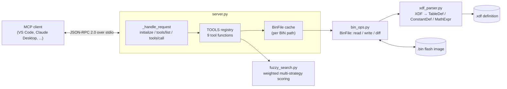

# simos-mcp

An MCP server that lets an AI assistant read, edit, diff and sanity-check VW/Audi Simos 18.1 ECU calibrations. It decodes TunerPro XDF definitions and applies them to raw BIN flash images.

<!--  -->
<!-- SHOT: hero.gif — VS Code chat (or Claude Desktop) with simos-mcp connected: ask "what changed between stock.bin and stage1.bin?", show the diff_bins summary, then a diff_table call rendering old -> new cells with RPM/load axis labels. 10–15 s. -->

## Overview

Tuning a Simos 18.1 ECU means working with large binary images whose only map is an XDF file: a long list of tables, each with its own address, element size, signedness, endianness and scaling equation. GUI editors work well for people, but an LLM can't use them. simos-mcp exposes that knowledge as Model Context Protocol tools, so an assistant can look up a table by an approximate name, read it in real units with axis labels, compare two tunes, check values against the XDF's limits and write changes back. It handles both ECU (Simos 18.1) and TCU (DQ250) XDF formats.

## Safety disclaimer

> **Writing to an ECU binary can damage an engine or transmission, or leave a control unit unbootable.** This project is a research and learning tool, not a flashing tool.
> - Write tools **overwrite the BIN in place by default** (`save: true`) and do **not** make a backup. Work on copies.
> - Write targets are resolved by **fuzzy name match**. Confirm the resolved table title in the response before you trust a write.
> - `validate_table` checks the XDF min/max range, but it is advisory. Writes are **not** blocked when values fall outside that range.
> - This tool does **not** recalculate checksums. Use your flashing software's checksum correction, and review every change with `diff_bins` before flashing.
> - Make sure modifications are legal for road use where you live. Use at your own risk.

## Features

- **List** every table and scalar in an XDF, filtered by category or title.
- **Search** with fuzzy matching, so `"ignitn timng"` still finds *Ignition Timing Base*.
- **Read** 2D tables as aligned text grids with scaled axis labels and units, and read single scalars.
- **Write** tables (optionally including their axes) and scalars in display units. The tool converts back to raw values.
- **Diff** two BINs: a compact per-table change summary first, then a cell-by-cell drill-down for one table.
- **Validate** a table against the min/max range declared in the XDF.

## Architecture



The server does not depend on an MCP SDK. `server.py` implements the JSON-RPC handshake and the `tools/list` and `tools/call` methods itself, and builds each tool's `inputSchema` from a parameter table: a parameter is marked required when it has no default. If no XDF path is given, `_find_xdf_for_bin()` uses the first `.xdf` it finds in the BIN's directory or that directory's parent. Each BIN is parsed once and cached, so repeated reads in one session don't re-parse the XDF.

## Engineering highlights

### 1. XDF parsing
**Problem:** an XDF is TunerPro's XML schema. Addresses are offsets that need a base offset and subtraction applied. Element width, signedness and byte order can each come from the global `DEFAULTS` or from a per-axis `mmedtypeflags` bitfield. An axis can be read from the BIN, defined by fixed labels, or linked to another table.
**Approach:** `xdf_parser.py` parses the file into dataclasses (`TableDef`, `AxisDef`, `ConstantDef`, `XdfHeader`). It applies `BASEOFFSET` to every address and decodes `mmedtypeflags` (bit 0 = signed, bit 1 = LSB-first). It falls back to header defaults only when the flags are zero, which matters because ECU and TCU XDFs differ there. Axis "display" entries (`"Table : x axis : var"`) are flagged so they don't pollute table lookups. `bin_ops.py` reads Z data in column-major order (`addr = base + (col * rows + row) * size`), which is the layout these XDFs use.
**Result:** the same code reads both the Simos 18.1 ECU and DQ250 TCU definitions listed under [Tested with](#tested-with).

### 2. Scaling math that runs in both directions
**Problem:** every value has a `MATH` equation (for example `X*0.75-24`) that converts raw counts to display units. A write needs the *inverse*, and XDF authors write equations in many styles, sometimes with typos like `2.66667.0`.
**Approach:** `MathExpr.forward()` normalizes known typos and evaluates the equation with no builtins and only `X` bound. `inverse()` first simplifies algebraic identities (`(1.0 * X)` becomes `X`, `X + 0.0` becomes `X`, redundant parentheses are dropped). It then matches the result against ten linear forms (`X*a`, `X/a + b`, `a - X`, …) and inverts it exactly. For anything else it brackets the target over ranges up to ±1e12 and bisects for 100 iterations. `_write_element()` rounds to the nearest raw integer and clamps it to the range of the element width, so an out-of-range value saturates instead of wrapping.
**Result:** writes are given in engineering units. The write response reads the table back from the buffer, so you see the *quantized* value that actually landed (for example 10.0° becomes 9.8° on a 0.75°/count table).

### 3. Fuzzy table lookup tuned for LLM queries
**Problem:** assistants rarely know the exact title of a calibration table, and a plain substring search either misses or returns hundreds of hits.
**Approach:** `fuzzy_search.py` scores each title with four weighted strategies: exact substring (40, scaled by how much of the title the query covers), all-tokens-present (25), `rapidfuzz.ratio` (25) and `partial_ratio` (10). A `token_set_ratio` bonus handles reordered words. Results carry a 0–100 score and a `match_type`. Lookup tools use a lower threshold and take the top hit, and the substring fallback in `_find_table()` ranks axis sub-tables below the main table.
**Result:** misspelled or reordered queries resolve to the intended table. Because of this, write targets should still be confirmed (see the [Safety disclaimer](#safety-disclaimer)).

### 4. Diff and validation built for a limited context window
**Problem:** dumping two full calibrations into an LLM context is wasteful and hard to review.
**Approach:** the diff has two levels. `diff_bins` returns one line per changed table, with changed and total cell counts and dimensions, plus the changed scalars. `diff_table` then lists `old -> new` for each changed cell, grouped by row and labelled with the real axis values. `validate_table` reports out-of-range cells against the XDF's `min`/`max`. Write tools take `save: false`, which updates only the cached in-memory image, so changes can be staged and inspected before anything touches disk.
**Result:** an assistant can answer "what did this tune change?" with a short summary and then drill into a single table.

## Tools

| Tool | Description | Required args |
|---|---|---|
| `list_tables` | List tables and scalars, optionally filtered by category or title | `bin_path` |
| `search_tables` | Fuzzy search across tables and scalars, scored 0–100 with a match type | `bin_path`, `search` |
| `read_table` | Read a table as a text grid with scaled axes and units | `bin_path`, `table_name` |
| `read_scalar` | Read a scalar/constant (display value, raw value and units) | `bin_path`, `scalar_name` |
| `write_table` | Write a 2D JSON array, with optional new x/y axes, and return a read-back preview | `bin_path`, `table_name`, `data` |
| `write_scalar` | Write a scalar in display units and return the old and new values | `bin_path`, `scalar_name`, `value` |
| `diff_bins` | Summary of every changed table and scalar between two BINs | `bin_path_a`, `bin_path_b` |
| `diff_table` | Cell-by-cell `old -> new` for one table, with axis labels | `bin_path_a`, `bin_path_b`, `table_name` |
| `validate_table` | Check a table against the XDF min/max | `bin_path`, `table_name` |

Every tool also accepts an optional `xdf_path` (`xdf_path_a`/`xdf_path_b` for the diff tools). The write tools accept `save` (default `true`).

## Tech stack

- **Language:** Python 3.10+, standard library only (`xml.etree`, `struct`, `json`, `dataclasses`)
- **Search:** [rapidfuzz](https://github.com/rapidfuzz/RapidFuzz)
- **Protocol:** Model Context Protocol (protocol version `2024-11-05`), JSON-RPC 2.0 over stdio

## Getting started

Requires Python 3.10 or newer. No environment variables are needed.

```bash
pip install rapidfuzz
python server.py          # speaks MCP over stdin/stdout
```

Smoke test (lists the 9 tools):

```bash
printf '%s\n' '{"jsonrpc":"2.0","id":1,"method":"initialize","params":{}}' \
              '{"jsonrpc":"2.0","id":2,"method":"tools/list"}' | python server.py
```

To install it as a `simosmcp` command instead:

```bash
pip install -e .
simosmcp                  # same as python server.py
```

### VS Code MCP config

Add to `.vscode/mcp.json`:

```json
{
  "servers": {
    "simos-mcp": {
      "type": "stdio",
      "command": "python",
      "args": ["path/to/simos-mcp/server.py"]
    }
  }
}
```

## Tested with

- `SC8S50_switchpatch29.33_v1.006.xdf` (ECU, Simos 18.1)
- `F45M_DSG_v1.007.xdf` (TCU, DQ250)

## Roadmap

- Safer writes: back up to `*.bin.bak` before saving, do atomic temp-file-plus-rename saves, require an exact `unique_id` match for writes, and add an option to reject out-of-range values.
- Replace `eval` in `MathExpr` with a small AST-based evaluator. XDF files come from third parties, and restricting builtins is not a sandbox.
- Support IEEE float32 elements (`mmedtypeflags` bit `0x10000`) and follow linked-axis `linkobjid` references. Add unit tests with a synthetic XDF/BIN fixture.
