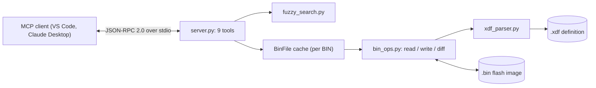

# simos-mcp

An MCP server that lets an AI assistant read, edit, diff and sanity-check VW/Audi Simos 18.1 ECU calibrations. It decodes TunerPro XDF definitions and applies them to raw BIN flash images, so the assistant can find a table by a rough name and read it in real units.

<!--  -->
<!-- SHOT: hero.gif — VS Code chat (or Claude Desktop) with simos-mcp connected: ask "what changed between stock.bin and stage1.bin?", show the diff_bins summary, then a diff_table call rendering old -> new cells with RPM/load axis labels. 10–15 s. -->

## Safety

Writing to an ECU binary can damage an engine or transmission, or leave a control unit unbootable. This is a research and learning tool, not a flashing tool.

- Write tools overwrite the BIN in place by default (`save: true`) and don't make a backup. Work on copies.
- Write targets are found by fuzzy name match. Check the resolved table title in the response before you trust a write.
- `validate_table` is advisory: out-of-range values aren't blocked. Checksums aren't recalculated either, so use your flashing software's checksum correction and review every change with `diff_bins`.
- Make sure your changes are legal for road use where you live. Use at your own risk.

## How it works



There's no MCP SDK. `server.py` handles the JSON-RPC handshake, `tools/list` and `tools/call` itself, and builds each tool's `inputSchema` from a parameter table (a parameter is required if it has no default). If you don't pass an XDF, it uses the first `.xdf` in the BIN's directory or its parent. Each BIN is parsed once and cached for the session.

## Interesting bits

- XDFs are fiddly. Addresses need `BASEOFFSET` applied, and element width, signedness and byte order come either from the global `DEFAULTS` or from a per-axis `mmedtypeflags` bitfield (bit 0 signed, bit 1 LSB-first). The parser only falls back to the header defaults when the flags are zero, since ECU and TCU XDFs differ there, and Z data is read column-major. The same code reads both the Simos 18.1 ECU and DQ250 TCU definitions.
- Every value has a `MATH` equation like `X*0.75-24`, and a write needs the inverse. `MathExpr.inverse()` simplifies identities like `(1.0 * X)`, matches the result against ten linear forms and inverts those exactly. Anything else gets bisected over a bracket of up to ±1e12. Writes round to the nearest raw integer and clamp to the element width, so out-of-range values saturate instead of wrapping. The response reads the table back, so you see what actually landed (10.0° becomes 9.8° on a 0.75°/count table).
- Assistants rarely know exact table titles. `fuzzy_search.py` mixes exact substring, all-tokens-present, `rapidfuzz.ratio` and `partial_ratio` scores (weighted 40/25/25/10) with a `token_set_ratio` bonus for reordered words, so `"ignitn timng"` still finds Ignition Timing Base.
- Two full calibrations don't belong in a context window. `diff_bins` returns one line per changed table (changed and total cell counts) plus changed scalars, and `diff_table` drills into one table as `old -> new` cells labelled with axis values. Writes with `save: false` only touch the cached image, so you can stage and inspect changes before anything hits disk.

The tools are `list_tables`, `search_tables`, `read_table`, `read_scalar`, `write_table`, `write_scalar`, `diff_bins`, `diff_table` and `validate_table`. Every tool also accepts an optional `xdf_path` (`xdf_path_a`/`xdf_path_b` for the diff tools).

## Running it

Python 3.10 or newer. No environment variables needed.

```bash
pip install rapidfuzz
python server.py          # speaks MCP over stdin/stdout

# smoke test: lists the 9 tools
printf '%s\n' '{"jsonrpc":"2.0","id":1,"method":"initialize","params":{}}' \
              '{"jsonrpc":"2.0","id":2,"method":"tools/list"}' | python server.py
```

Or `pip install -e .` to get a `simosmcp` command. For VS Code, add this to `.vscode/mcp.json`:

```json
{
  "servers": {
    "simos-mcp": {
      "type": "stdio",
      "command": "python",
      "args": ["path/to/simos-mcp/server.py"]
    }
  }
}
```

Tested with `SC8S50_switchpatch29.33_v1.006.xdf` (ECU, Simos 18.1) and `F45M_DSG_v1.007.xdf` (TCU, DQ250).

Stack: Python 3.10+ (standard library only), rapidfuzz, MCP protocol `2024-11-05`.

Next up: back up to `*.bin.bak` and save atomically, require an exact `unique_id` match for writes, and replace the `eval` in `MathExpr` with a small AST evaluator, since XDFs come from third parties and restricting builtins isn't a sandbox.
